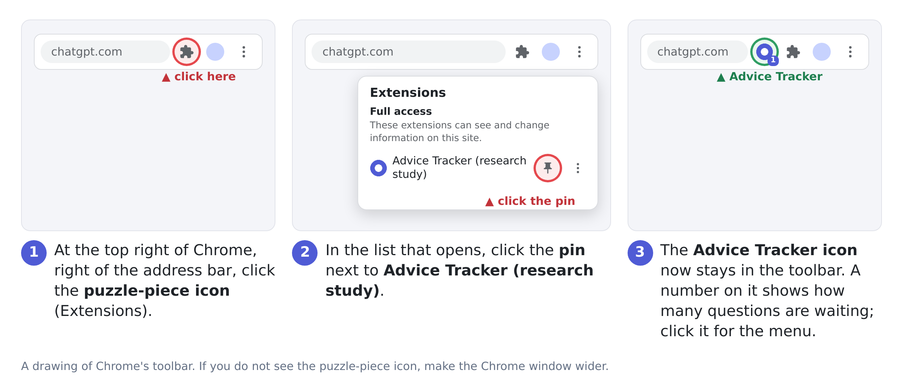

# Advice Tracker (research study extension)

A Chrome extension used in a university research study on how people ask AI chat assistants
(ChatGPT, Claude, Gemini, Grok, Perplexity) for advice about their own lives, and what happens
afterwards. When part of a conversation looks like you asked the AI for advice about your own
situation, the extension asks whether you really asked for advice, and then a few questions about
the advice (about 1 to 2 minutes; when it asks is explained below). From a week later it asks
whether you made a decision and acted on it, and then how things went (about 4 to 8 minutes). Your answers stay on your
computer until you press **Submit**; they are then sent together with that advice conversation (your
messages and the AI's replies, from your message that asked for advice on), after names, e-mail
addresses, phone numbers and similar details were removed on your computer. If you answer that it was
not advice, that part of the conversation is sent with your No, in the same way.

This folder is the extension itself, so it can be loaded straight into Chrome. A Chrome Web Store
version (one-click install) is in preparation; until then, follow the steps below.

**How it works, in detail:** [`docs/advice-tracker-design.pdf`](docs/advice-tracker-design.pdf).

## What's new in version 0.6.23

- Conversations on your other devices are read from one minute after you resume tracking (ten
  minutes before). Messages sent while tracking was paused are still never read.

In 0.6.22:

- **Show captured messages on this tab** numbers each of your messages with its turn in the
  conversation, and says when the page shows only part of it: a site such as ChatGPT draws only
  some turns at a time (for example after you come back to its tab), and the others are still
  counted in "captured".

In 0.6.21:

- **Show captured messages on this tab** closes again when you click it a second time, as the
  feedback buttons do.

In 0.6.19:

- Reading the sites: the older pages of a site's conversation list are reached also when the list
  is refreshed often (the test build's Test timings).

In 0.6.18:

- **Questions about a conversation from your phone (or another device) come by themselves**, on a
  page of that site that you have open, once you have not typed there for 5 minutes. You no longer
  need to open that conversation for them to appear. The follow-up questions come the same way.
- **An update you missed** ("Update your ratings?" closed before you answered it) is now listed on
  the Quick check-ins page, with your earlier answers filled in and a **No changes** button, until
  you update your answers or say that nothing changed.
- **Show captured messages on this tab** shows what it found right under the button (it was out of
  sight at the bottom of the menu).

In 0.6.17:

- **Past conversations: up to 20.** You can annotate up to 20 past conversations ($2 each, so up
  to $40); before, the limit was 30.

In 0.6.16:

- **Your conversation on the Outcomes page.** With the outcome questions of an advice conversation,
  and with the questions about a past conversation, the Outcomes page now shows you the
  conversation (your messages and the AI's replies) with names, e-mail addresses, phone numbers and
  similar details already removed, in a box you can edit. You can delete anything else you do not
  want us to keep; the conversation is then stored with your answers.

In 0.6.15:

- **A reminder at the end of a study week.** At the end of weeks 1, 2 and 3, and at the end of week
  5, the extension looks at whether you were active and whether due tasks are left: in weeks 1 to 3
  the quick questions of advice conversations you have not answered, at the end of week 5 the
  outcome questions. If something is missing, it reminds you by itself and names the day by which
  to finish (three days later).
- **Messages from the study team.** The study team can also send you a message through the
  extension, for example a request to update. Reminders and messages show as a Chrome
  notification and in a small window on your AI chat pages until you click **OK, I have read it**,
  and stay under the extension icon → **Messages from the study team**.
- **Numbered labels for personal details.** In what is sent to the study, a name is no longer
  replaced by `[NAME]` but by `[NAME1]`, `[NAME2]`, ...: the same name gets the same label wherever
  it comes up, so the study team can tell that two mentions are the same person without knowing
  who. The same holds for e-mail addresses, phone numbers and the other details.
- **The outcome questions** now begin with "Did you follow or plan to follow the advice?" (with
  answers that say whether the AI reinforced or changed your decision) and "What did you actually
  do, or decide, and why?".
- **Study rules** match the current consent form: what happens when you were not active or answers
  are late, and that past conversations are paid when answered on time.
- **Keep the extension's folder** where it is for the whole study: see *Install*, step 1.

In 0.6.14:

- **The study's five weeks.** New advice conversations are collected until the end of week 3. In
  week 4 only conversations that began before are still followed. All follow-up questions, and the
  questions about past conversations, are due by the end of week 5. The menu under the extension
  icon shows which week you are in.
- **Study rules.** *Study rules: payments and participation*, under the extension icon, shows your
  own calendar (when each week ends, when payments come) and the study's rules.
- **Too early to tell.** When the outcome questions come and it is too early to tell how things
  turned out, say so with one click: they come back two days later. In week 5 they are due.
- **A reminder every two days** while anything on your Outcomes page is unanswered.
- **Pause tracking** first shows what a pause means for your payment.
- **Report an advice conversation we missed**, under the extension icon, tells the study team about
  a conversation in which you asked for advice and the extension did not ask you about.
- Updating your answers when an advice conversation goes on is encouraged, not required.
- With your answers, the extension now also sends how long you took to answer, and twice a day
  when you last sent a message to one of the five AI assistants (the time only, never the text).

In 0.6.13:

- The times the extension tells you match the consent form: about 1 to 2 minutes for the quick
  questions, about 4 to 8 minutes for the outcome questions and for each past conversation.

In 0.6.12:

- Your **Participant ID is your Prolific ID**.
- An advice conversation now lasts until you change the topic, or until a week after you first
  asked (a day without activity no longer ends it).
- **Send feedback on the study**, under the extension icon, sends the study team anything you want
  them to know.
- When you answer **No** (not advice), that part of the conversation is sent with your No, with
  personal details removed, so the study can see what its model got wrong.

Earlier versions, and the details: [CHANGELOG.md](CHANGELOG.md).

## What you need

- Google Chrome on a computer or laptop (version 121 or newer, from January 2024; Edge and Brave also work).
- An internet connection.
- Your **Prolific ID**: it is your Participant ID in the study.

## Install (about two minutes)

1. **Get the code.** On this page click the green **Code** button → **Download ZIP**, then
   unzip it. You get a folder named `advice_tracker_plugin-main` (`-dev` for the dev branch)
   containing `manifest.json`.
   Put this folder somewhere permanent (Documents, not Downloads) **before** you go on.
   **Do not delete, move or rename this folder during the five weeks of the study**: Chrome runs
   the extension from it every time it starts. Without the folder Chrome turns the extension off,
   and the answers and conversations it keeps on your computer for the study are lost with it.
   *(Alternatively: `git clone https://github.com/Bill1235813/advice_tracker_plugin.git`.)*
2. **Open the extensions page.** Paste `chrome://extensions` into the address bar and press
   Enter (or Menu ⋮ → Extensions → Manage Extensions).
3. **Turn on Developer mode** with the switch in the top-right corner.
4. Click **Load unpacked** (top left) and select the unzipped folder, the one that contains
   `manifest.json`. The card **Advice Tracker (research study)** appears.
5. The **settings page opens by itself.** Type your Participant ID (your Prolific ID) and click
   **Save**.
   *(If the page did not open: click the puzzle-piece icon → Advice Tracker → ⋮ → Options.)*
6. **Pin the icon**, so that it stays visible and shows how many questions are waiting:
   click the **puzzle-piece icon** (Extensions) at the top right of Chrome, to the right of the
   address bar; in the list that opens, click the **pin** next to *Advice Tracker (research
   study)*. The Advice Tracker icon now stays next to the puzzle piece.

   
7. **Reload any chat tabs** that were already open (the extension only attaches to pages
   opened after it was installed).

Ignore the "Developer mode extensions" reminder Chrome may show at startup; it is normal for an
extension loaded this way.

## Try it once

1. Go to https://chatgpt.com (or claude.ai, gemini.google.com, grok.com, perplexity.ai), start a
   **new** chat, and ask for advice about a decision as you normally would, for example:
   *"I have two job offers, one pays more but the other is closer to family. Which should I
   take?"*. Let the assistant answer; ask a follow-up if you like.
2. Right after the assistant's first answer, a small pop-up asks only "Did you ask for advice
   here?". The questions come after 3 minutes without typing, a new chat, or a change of subject
   (*"Unrelated: what is the capital of Peru?"*), whichever is first. (This is the study's
   *Combined* mode; the research team sets it, and the popup under the extension icon shows it.)
3. A small **Quick check-in** panel appears at the bottom right of the chat page. The panel
   quotes your request and asks **"Did you ask for advice here?"** (only if you did not answer Yes
   in the pop-up).
4. Click **Yes**, answer all the questions (each one is required), and press **Submit**. Your
   answers are sent with the conversation, after personal details were removed on your computer.
   If it was not advice, click **No**: that part of the conversation is sent with your No.
5. Click the extension icon: *Advice conversations found* shows 1. A chat with only a factual
   question ("What is the capital of Peru?") should **not** trigger the panel.

**Where things go when you click "later"**: the panel comes back after an hour if the chat tab is
still open, otherwise a Chrome notification reminds you. At any time, click the extension icon →
**Quick check-ins** to answer everything that is waiting; a number on the icon shows how many
things are waiting.

From a week after an advice conversation, a small pop-up on a chat site's page asks whether you made
a decision about it and acted on it, and then how things turned out. If it is too early to tell, say
so, and it asks again two days later. Everything you have not answered yet, and the past
conversations, are on the **Outcomes** page (extension icon → Outcomes); a Chrome notification
reminds you of it every two days while anything there is unanswered. In week 5 of your study the
outcome questions of every advice conversation are due, even if you have not acted yet or it is too
early to tell. With the outcome questions, the Outcomes page shows you the conversation with names,
e-mail addresses, phone numbers and similar details already removed, in a box you can edit: delete
anything else you do not want us to keep before you submit.

## The study's weeks and rules

The study lasts five weeks, counted from when you saved your Participant ID. Click the extension
icon → **Study rules: payments and participation** for your own calendar, what you are paid and
when, and the rules (they are the consent form's). In short:

- **Weeks 1 to 3:** use the AI assistants as usual. The extension looks for advice conversations and
  asks its quick questions.
- **Week 4:** no new advice conversations are collected. One that began before is still followed if
  you continue it, until the end of the week. Follow-up questions go on.
- **Week 5:** the outcome questions of every advice conversation, and the questions about past
  conversations, are due by the end of the week.
- **Pausing:** under 12 hours nothing happens; from 12 to 24 hours you get a reminder and your
  payment is not affected; from 24 hours to 1 week your payment for that week is reduced for the
  time paused; after more than 1 week your participation in the study ends.
- **Your answers are reviewed** by the study team. Updating them when a conversation goes on is
  encouraged, not required. If the extension asks about a conversation that was not advice, answer
  **No**; if it misses one, please use **Report an advice conversation we missed**.
- **A reminder at the end of weeks 1, 2, 3 and 5**, if you were not active in that time or have due
  tasks left (weeks 1 to 3: quick questions not answered; week 5: outcome questions not answered):
  the extension sends it by itself, with the day by which to finish, three days later.
- **Messages from the study team** (for example a request to update) and these reminders show as
  a notification and on your AI chat pages, and stay under the extension icon → **Messages from
  the study team**.

## What it collects, and your controls

- It works only on the five chat sites above and reads nothing else (no browsing history, no
  passwords, no other websites).
- **From the end of week 3 of your study, new conversations are no longer checked**: a message is
  sent to the study's AI model only if it continues an advice conversation that began before, and
  from the end of week 4 none is (past conversations, if you turned them on, are still read).
- **Only the messages you send while tracking is on are processed** (your participant ID is set,
  tracking is not paused, and the site is not excluded). Opening an old chat from the sidebar never
  sends anything; if you continue an old chat, only your new messages are checked. The one
  exception is the reading of other-device conversations, and of past ones if you turned that on
  (next point).
- **Other devices (always), and past conversations (only if you turned them on with one click on the
  settings page):** the extension reads your conversation list and conversations through the
  site's own web interface, in this browser, while a page of the site is open, at most once a
  minute. Other-device conversations are those after you joined that the web page did not see;
  past conversations go back up to 90 days before you joined. Messages sent while tracking was paused,
  on an excluded site, on days the extension was not running, or before you last used "Delete all
  data" are never read (they do not even leave the chat page into the extension). On each site,
  only the account you were signed in with the first time is read, whether it is a personal one or a
  work, school or team one; while another account or workspace is open there, reading that site
  stops (on Grok, which does not say which account is signed in, one account in this browser is
  assumed, and reading stops while the conversation list looks like someone else's). The messages are
  checked by the study's AI model like those on the web; a conversation's text is sent only with
  your answers about it, or with your No (for a past one, the conversation is shown to you as it
  will be sent).
  The text of a conversation found but not answered stays on your computer at most 42 days. To keep
  a conversation out, pause tracking: turning the extension off does not keep out what you type
  on your phone meanwhile. "Delete all data" also turns past conversations off.
- **To find advice conversations**, each message you send is checked by the study's own AI model,
  which runs on university computers (no commercial AI service sees your messages). For this
  check the extension sends your new message, your earlier messages in the same part of the
  conversation and, to tell whether you are still on the same topic, the assistant's previous
  reply, all with personal details already replaced on your computer. The study server keeps
  only the yes/no result, never the text, and records no IP addresses.
- **Attachments are recorded by name only**: an uploaded picture appears as `[image]` and a file as
  `[file: its name]`; the extension never reads what is inside them.
- On your computer, a conversation's text is kept only while it is being checked; for an advice
  conversation you answer questions about, until you answer its outcome questions. Conversations
  the study's model finds not to be advice are deleted, and their text is never sent.
- Your answers are sent when you press Submit, together with the advice conversation they are
  about (your messages and the AI's replies, from your message that asked for advice on; earlier
  messages of the chat are not sent); the complete conversation is sent once more when it ends (if
  tracking is paused then, once it is on again; never if you exclude the site).
- With the outcome questions of an advice conversation, the **Outcomes** page shows you that
  conversation (your messages and the AI's replies) with personal details already removed, in a box
  you can edit. You can delete anything else you do not want us to keep; the conversation is then
  stored on our study server with your answers. The questions about a past conversation show its
  conversation in the same way, and a past conversation you edited is sent only as you left it.
- When you answer **No** (not advice), that part of the conversation is sent with your No in the
  same way (from the message the model took for an advice request on, with personal details
  removed), so the study team can see what the model got wrong; the conversation is then deleted
  from your computer. A past conversation you **Skip** is deleted and its text is not sent.
  Names, e-mail addresses, phone numbers, web and street addresses, long numbers and similar
  details are replaced with labels on your computer before anything is sent; add the names that
  matter most to you in the settings. In what the study stores (your answers, the conversations sent
  with them, your feedback) the labels are numbered: the first name is `[NAME1]`, the next
  `[NAME2]`, and the same name gets the same label again, in any of your conversations (capital
  and small letters make no difference), so the study team can tell that two mentions are
  the same person without knowing who it is. The numbers are your own: `[NAME1]` of two
  participants are two people. To keep them the same, the extension keeps a table on your
  computer, which never leaves it and holds a fingerprint of each detail, not the detail itself;
  "Delete all data" empties it. (The messages checked by the study's AI model have labels without
  numbers, as before.)
- Twice a day the extension sends a heartbeat with counts (found / rated / not advice), whether
  tracking is on (paused or not, and on which of the five sites it can capture), and when you last
  sent a message to one of the five AI assistants (the time only, never the text). A change of what
  is tracked is reported when it happens, and removing the extension is reported too. The study team
  uses this to know that the extension is still installed and when it was tracking (see *Study
  rules* for what a pause means for payment).
- After each heartbeat the extension asks the study server whether the study team has a **message**
  for your participant ID, and tells the server when a message arrived and when you clicked OK on
  it. A message is shown as plain text.
- At the end of each of weeks 1 to 3 and of week 5, and three days later, the extension tells the
  study server what it found: whether you were active (an advice conversation, answers, feedback:
  yes or no for each), how many advice conversations still have due questions, and whether it
  reminded you. Counts and times only, nothing of a conversation.
- With each set of answers the extension sends how long the questions took you (when they appeared,
  when you finished the first and the last answer, when you pressed Submit). The study team uses it
  when it reviews the quality of the answers.
- An advice conversation ends when the topic changes, or a week after your first advice request in
  it, whichever comes first.
- Settings page (icon → ⋮ → Options): **pause** tracking, **exclude sites**, list **names to
  remove** from conversations before they are sent, turn **past conversations** on or off,
  **export** or **delete all** data on this computer.
- **Feedback** you type under the extension icon (*Send feedback on the study*, or *Report an advice
  conversation we missed*) is sent to the study team with your participant ID, with names on your
  list, e-mail addresses, phone numbers and similar details replaced on your computer first, as for
  conversations.
- Putting a panel off ("later") or answering "No" never affects your participation.

Full privacy policy: the link in the study e-mail.

## If something does not work

- **Cannot type in the panel's text boxes** (seen on claude.ai): click **open in a tab** in the
  panel's header; the same questions open in a separate tab where typing always works.
- **No panel appears** after an advice conversation: the panel comes when the rating mode says so
  (see *Try it once*; the popup under the extension icon shows the mode), and you need to be
  online. Then click the icon → *Show captured messages on
  this tab*: it lists the messages the extension sees and how many of your messages in this
  conversation it captured. If it says "No messages found on this page", the chat site changed its
  page layout; if it counts 0 captured messages although you sent some, tell the study team which
  site (both are quick fixes). If the popup says "No access to ...", allow the site again under
  `chrome://extensions` → Advice Tracker → Details → Site access.
- **"No participant ID set"** in the popup: open the settings page and save your ID.
- **"Advice Tracker was updated meanwhile"** in a panel: the extension was updated or reloaded while
  the panel was open, so it could not send your answer. Reload the chat page; questions that still
  wait for an answer are listed under the extension icon → **Quick check-ins** and **Outcomes**.
- **Chrome removed the extension** after an update: repeat "Load unpacked" from the same folder.
- **No past or other-device conversations are found**: they are read only while a page of the site
  is open, a little at a time (one request a minute to each site), and only for the account you were signed in
  with the first time the extension read the site. If a site stops answering (it may ask the
  extension to wait, or refuse), reading that site pauses by itself; the study team sees this in the
  heartbeat.
- **Anything else**: tell the study team with *Send feedback on the study* under the extension icon,
  or e-mail them, with what you did and what you saw; the service-worker log (`chrome://extensions`
  → Advice Tracker → *Inspect views: service worker*) helps if you are comfortable copying it.

## Updating and uninstalling

- **Update**: download the ZIP again, replace the contents of your folder (the same folder, in
  the same place and with the same name: do not delete it first), then on
  `chrome://extensions` click the circular reload arrow on the Advice Tracker card and reload
  your chat tabs. (The Web Store version will update itself.)
- **Uninstall / withdraw**: `chrome://extensions` → **Remove** on the card. To also wipe the local
  data first: Options → *Delete all data on this computer*.

## For reviewers and developers

- `manifest.json` (Manifest V3, version 0.6.23): permissions `storage`, `unlimitedStorage` (no
  install warning), `alarms`, `notifications`, and host permissions for the five chat sites (plus
  `localhost` for the mock test page); no remote code.
- Past and other-device conversations (0.6; past ones opt-in, other devices always read since
  0.6.11): `content/history.js` answers the worker's
  requests with the site's reader (`lib/history/<site>.js`: the conversation list and one
  conversation, through the site's own read-only API); `lib/history.js` sorts each turn by who sent
  it (web, past, app, off) and drops the text of turns that may not be read before it leaves the
  page; `background.js` walks each conversation with the same judges, hands open episodes between
  the web page and the walk, and asks through one queue per site (`lib/modes.js` `viaQueue`,
  `queueItem`): a text-free invitation on the site's page, the questions in `ui/checkin.html?item=` (a
  past one in `ui/outcomes.html?item=`, 0.6.9).
- `content/capture.js` reads the conversation from the page (per site, `lib/sites.js` names the
  message elements, the parts that hold their text, and the noise inside them: thinking blocks,
  screen-reader labels, buttons) and notes which user messages were sent there; `background.js`
  judges each new message through the study server, one at a time,
  following the state machine in `lib/episodes.js`, and shows `content/rating_panel.js` (or its small
  update and confirm pop-ups) when the rating mode in `lib/modes.js` says so; `lib/redact.js` removes
  personal details from everything sent; `ui/checkin.html` holds pending questions (the quick
  check-ins) and `ui/outcomes.html` the follow-ups and past conversations (one script for both,
  `ui/checkin.js`); `lib/modes.js` `followupStage` and `followupAnswer` are the follow-up's rules
  (0.6.9); `lib/questions.js` has every question (all required); `config.js` holds the server URL
  and study key, the servers used before (an update moves an install that still has one of
  them to the current server), and the study's weeks in days from when the participant joined
  (0.6.14: `newAdviceDays` 21, `continueDays` 28, `studyDays` 35; `background.js` `studyDay`,
  `cutOf`); `ui/rules.html` is the study rules page, with the participant's calendar
  (`ui/rules.js`); `ui/messages.html` lists the messages from the study team (0.6.15:
  `background.js` `fetchTeamMessages`, `offerTeamMessage`, `onTeamMessageRead`;
  `content/rating_panel.js` `showMessage`). The settings page hides the research team's settings (the server
  and key, the follow-up time, the quiet time) since 0.6.12: `options/options.html?advanced`
  shows them, for a test.
- Uploads (`POST /events`; the episode events carry `source`: web, app or past; an answer to a
  question that does not apply is `null`, e.g. `outcome` when `too_early` is ticked, `feel_better`
  unless `followed` is `reinforced`, `ai_changed` or `partly`; until 0.6.14 the answers of
  `followed` were `fully`, `partly`, `plan`, `against`, `changed`, `forgot`). Since 0.6.14
  `episode_rating`, `checkin` and
  `past_annotation` carry `timing`: `shown_at`, `first_answer_at`, `last_answer_at`, `submitted_at`
  and `seconds` (from the first answer finished to the last; `null` when nothing on the form
  changed, or the page was older than 0.6.14). Since 0.6.15 the placeholders in every uploaded
  text (transcripts, free-text answers, feedback) are numbered per participant (`[NAME1]`,
  `[EMAIL2]`, `[file: NAME1_cv.pdf]`; `lib/redact.js`, the table is `redactNumbers` in the
  extension's storage); the `redacted` counts are as before, and the texts of `POST /judge` keep
  the placeholders without numbers. Since 0.6.20 each `POST /judge` also carries `chat`, the chat's
  code: `Episodes.hash` of the chat's key, the part of its episodes' ids before the first `-` (no
  text; relay 0.6.6 keeps it with the judgment, an older relay ignores it). A reinstall, a second computer or "Delete all data" starts
  new numbers (after a delete they go on from the last one, so no number is used twice).
  - `episode_rating`: answers + the redacted transcript from the opening turn through the answered one.
  - `episode_transcript`: the complete redacted transcript from the opening turn, when an answered
    episode ends (or when tracking is on again, if it ended while tracking was off), with
    `answer_versions` and `final_due` (false when a change of topic or the cut closes an answered
    episode with nothing new since the answers: the last `episode_rating` stands as the final one).
  - `not_advice`: the participant's No (`had_answers`: answers sent before belong to a removed
    episode), with the redacted `transcript` from the opening turn through the episode's last turn,
    as `episode_rating` sends it, and the `redacted` counts (`null` where the text stays, as with
    answers); a past one also its `fingerprint` and `opened_at`.
  - `checkin`: the outcome answers, with `followup` (`ask_from`, `due_at`, `shown`, `final_call`:
    answered in the study's last week, when they are due; and the answers with their times:
    `decided`, `decidedAt`, `acted`, `actedAt`, `actWhen`, `plannedAt`, `tooEarly`: how often "too
    early to tell" put them off, `tooEarlyAt`); `too_early` is `[]` when the form had the button
    instead of the box (before the last week). Since 0.6.16 also the conversation as the
    participant left it in the review box of the outcomes page (`ui/checkin.js` `showReview`):
    `transcript` (a text, `USER: ...` and `ASSISTANT: ...` paragraphs from the opening turn on,
    redacted once more), `transcript_edited` (whether they changed the text shown) and
    `transcript_chars` (`shown`, `kept`: how long the text was as shown and as they left it); none
    where the text stays on the computer. The unedited conversation is in the episode's
    `episode_rating` and `episode_transcript`, so the two can be compared. (Before 0.6.16 only an
    episode from 0.4 had the box.)
  - `followup`: each answer to the follow-up's questions (`step` decided, acted, when or outcome,
    `answer` (for outcome: `early`, too early to tell, or `yes`, "I can tell now"), `where` popup or
    page, the `stage` after it, `days_since_request`, `next_at`, `planned_at`, `due_at`,
    `too_early`, `shown`, `study_end`; no text).
  - `past_annotation` (answers + the redacted transcript of a past conversation, with a
    `fingerprint` to pay each once; since 0.6.16 `transcript_edited` and `transcript_chars` as in
    `checkin`, and when the participant edited the conversation in its review box, `transcript` is
    `null` and `transcript_reviewed` holds the text as they left it: the unedited one is not
    sent), `past_skipped`, and `consent` (`feature`, `accepted`, `version`).
  - `prompt`: a question shown (kinds include `invite` and `card`); it can end `withdrawn` (the pop-up
    or invitation was taken away because the participant answered the same question elsewhere). Since
    0.6.18 an `update` prompt also says `where` it was answered: `popup` (the chat page's pop-up) or
    `page` (**No changes** on the Quick check-ins page, which lists an update offered and not given:
    `lib/modes.js` `updateMissed`).
  - `heartbeat` (twice a day) and `status` (on a change): `tracking`, `paused`, `paused_at`,
    `listening_sites`, `excluded_sites`, `sites_without_access`, `read_past`, `read_apps`; the
    heartbeat also the extension's `version`, `history` (per site: ok, not_yet, waiting, signed_out,
    other_account, blocked, unsupported), `waiting_past`, `joined_at`, `joined_estimated`,
    `install_id`, `followup_stages`, `last_message_at` (0.6.14: when the participant last sent a
    message on one of the five sites, or on another device as read from the site) and counts (among
    them `feedback`, `feedback_missed_advice`, `upload_rejected`, `upload_rejected_<type>`).
  - `feedback`: what the participant typed under the extension icon (`text`, redacted on the
    computer), its `kind` (0.6.14: `feedback`, or `missed_advice` for a report of an advice
    conversation the extension did not ask about), the `redacted` counts and the extension's `version`.
  - `team_message` (0.6.15): a message from the study team arrived on this computer (`message`: its
    id, `state` `received`) or the participant clicked OK on it (`state` `read`, `where`: chat,
    popup or page, `seconds_waited`). The heartbeat carries `unread_messages`. The extension's own
    reminder at the end of a study week is such a message too (`message` `week-1`, ..., `week-4-5`,
    with `automatic: true`).
  - `week_status` (0.6.15, `background.js` `weekCheck`, `lib/modes.js` `studyPeriods`,
    `recordActivity`, `dueLeft`): what the extension found at the end of a paid part of the study
    (`week` `1`, `2`, `3` or `4-5`; `moment` `end`) and three days later (`moment` `deadline`):
    `ended_at`, `deadline_at`, `active`, `active_by` (`advice`, `answers`, `feedback` within the
    part), `due_left` (conversations whose due questions are not answered: in weeks 1 to 3 the
    quick questions that wait on the Quick check-ins page, i.e. conversations never answered that
    ended, were asked about, or were found on another device; the outcome questions at the end of
    week 5; never a past conversation),
    `reminded` (at the end: a reminder was shown), `active_after_end` (at the deadline: answers or
    feedback in the three days). A part whose three days were over before 0.6.15 was installed
    sends nothing.
- The extension also asks `GET /past?participant_id=` for the fingerprints of the past conversations
  the participant ID annotated, on any install, `GET /messages?participant_id=&version=` (0.6.15,
  after each heartbeat and when the messages page opens) for the study team's messages this
  participant ID has not read yet (`{messages: [{id, title, text, sent_at}]}`; an id is at most 80
  letters, digits, `.`, `_` or `-`; the server sends a message until it has the `read` event), and
  `GET /config`, whose `{history: {"<site>": false}}`
  stops reading a site. On removal Chrome opens `<server>/uninstalled?participant_id=...&key=...`,
  which the study server must answer (it records an `uninstalled` event). Each version's changes to
  these: [CHANGELOG.md](CHANGELOG.md).
- The design document is in `docs/`. The study server, the GPU worker, the tests (unit tests, a
  headless-browser end-to-end test, a smoke test) and the Web Store package live in the
  `plugin/` folder of the main research project.
